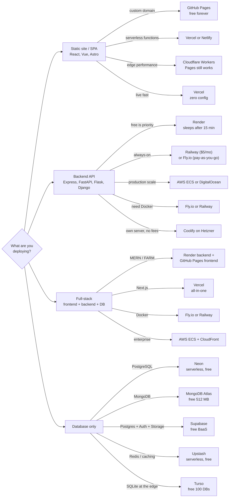
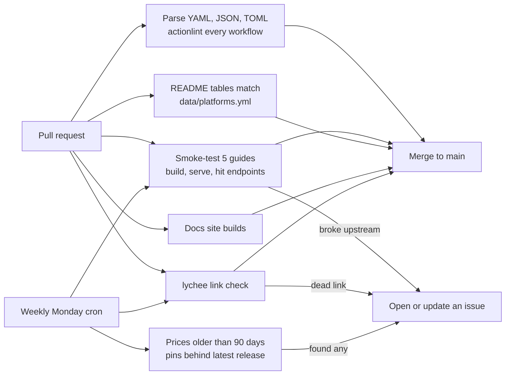
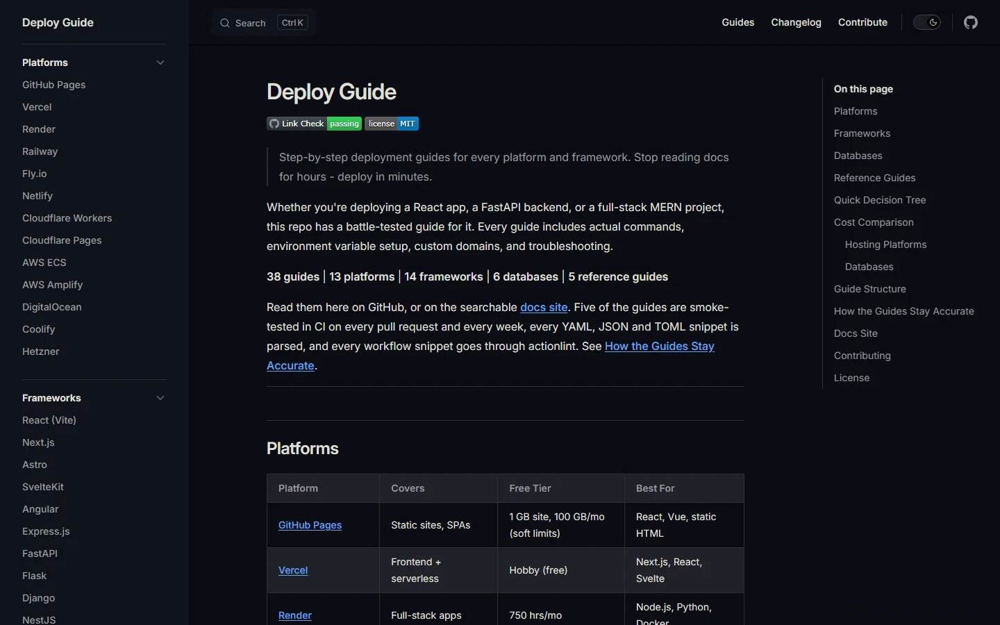
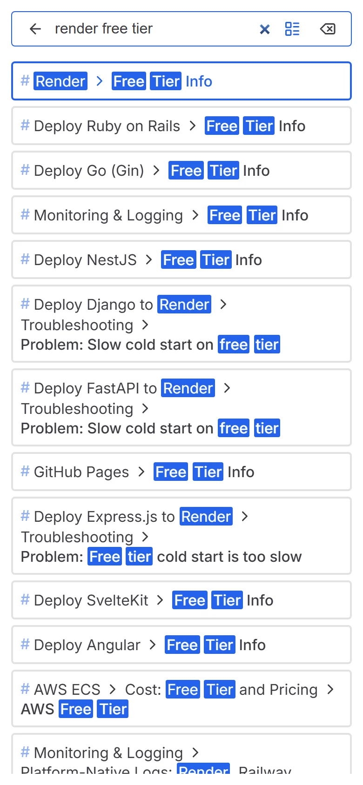
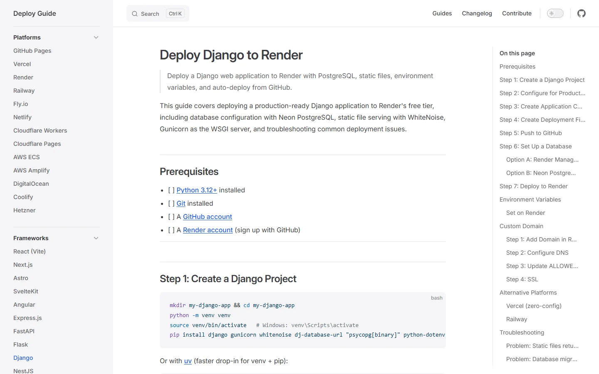
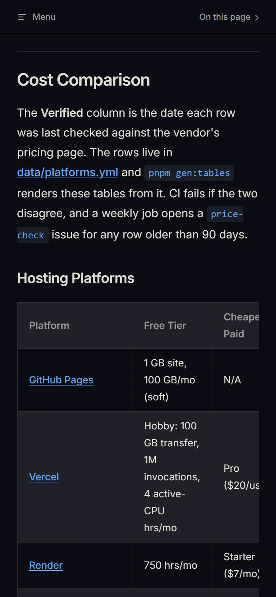

# Deploy Guide

[](https://github.com/Sagargupta16/deploy-guide/actions/workflows/link-check.yml)
[](LICENSE)

> Step-by-step deployment guides for every platform and framework. Stop reading docs for hours - deploy in minutes.

Whether you're deploying a React app, a FastAPI backend, or a full-stack MERN project, this repo has a battle-tested guide for it. Every guide includes actual commands, environment variable setup, custom domains, and troubleshooting.

**38 guides** | **13 platforms** | **14 frameworks** | **6 databases** | **5 reference guides**

Read them here on GitHub, or on the searchable [docs site](#docs-site). Five of the guides are smoke-tested in CI on every pull request and every week, every YAML, JSON and TOML snippet is parsed, and every workflow snippet goes through actionlint. See [How the Guides Stay Accurate](#how-the-guides-stay-accurate).

---

## Platforms

| Platform | Covers | Free Tier | Best For |
|----------|--------|-----------|----------|
| [GitHub Pages](guides/github-pages.md) | Static sites, SPAs | 1 GB site, 100 GB/mo (soft limits) | React, Vue, static HTML |
| [Vercel](guides/vercel.md) | Frontend + serverless | Hobby (free) | Next.js, React, Svelte |
| [Render](guides/render.md) | Full-stack apps | 750 hrs/mo | Node.js, Python, Docker |
| [Railway](guides/railway.md) | Full-stack + databases | One-time $5 trial | Any stack |
| [Fly.io](guides/fly-io.md) | Edge computing, Docker | None (pay-as-you-go) | Docker, Go, multi-region |
| [Netlify](guides/netlify.md) | JAMstack, forms | 300 credits/mo | Static, serverless, forms |
| [Cloudflare Workers](guides/cloudflare-workers.md) | Edge-first, static assets + SSR | 100K Worker req/day (assets free) | New edge projects, D1, KV |
| [Cloudflare Pages](guides/cloudflare-pages.md) | Edge-first, full-stack | Unlimited bandwidth | Static, D1, KV, Workers |
| [AWS ECS](guides/aws-ecs.md) | Production containers | $100-$200 credits (6 months) | Enterprise, Fargate |
| [AWS Amplify](guides/aws-amplify.md) | Full-stack serverless | 1000 build min/mo | CI/CD, preview environments |
| [DigitalOcean](guides/digitalocean.md) | VPS + App Platform | $200 credit (60 days) | Self-hosted, full control |
| [Coolify](guides/coolify.md) | Self-hosted PaaS | Free (bring your own server) | Push-to-deploy on any VPS |
| [Hetzner](guides/hetzner.md) | VPS (EU pricing) | None (from ~EUR 6/mo) | Docker Compose, full control |

## Frameworks

| Framework | Covers | Recommended Platform |
|-----------|--------|---------------------|
| [React (Vite)](frameworks/react-vite.md) | SPA deployment | GitHub Pages / Vercel |
| [Next.js](frameworks/nextjs.md) | SSR / SSG / ISR | Vercel |
| [Astro](frameworks/astro.md) | Static + server output | GitHub Pages / Netlify / Vercel |
| [SvelteKit](frameworks/sveltekit.md) | Adapter-based SSR / static | Vercel / Cloudflare |
| [Angular](frameworks/angular.md) | SPA + SSR deployment | GitHub Pages / Vercel |
| [Express.js](frameworks/express.md) | Node.js backend | Render / Railway |
| [FastAPI](frameworks/fastapi.md) | Python backend | Render / Railway |
| [Flask](frameworks/flask.md) | Python backend | Render / Railway |
| [Django](frameworks/django.md) | Python full-stack | Render / Railway |
| [NestJS](frameworks/nestjs.md) | Node.js backend (TypeScript) | Render / Railway |
| [Ruby on Rails](frameworks/rails.md) | Ruby full-stack | Render / Railway |
| [Go (Gin)](frameworks/go-gin.md) | Go backend | Railway / Render |
| [MERN Stack](frameworks/mern.md) | Full-stack (Mongo + Express + React + Node) | Render + GitHub Pages |
| [FARM Stack](frameworks/farm.md) | Full-stack (FastAPI + React + MongoDB) | Render + GitHub Pages |

## Databases

| Database | Guide | Type | Free Tier |
|----------|-------|------|-----------|
| [MongoDB Atlas](guides/mongodb-atlas.md) | Cloud MongoDB | Document (NoSQL) | 512 MB |
| [Neon](guides/neon.md) | Serverless PostgreSQL | Relational | 0.5 GB + 100 CU-hrs per project |
| [Supabase](guides/supabase.md) | Postgres + Auth + Storage + Realtime | BaaS | 500 MB + 50K MAU |
| [Upstash](guides/upstash.md) | Serverless Redis + QStash | Cache / Queue | 500K commands/mo |
| [Turso](guides/turso.md) | Edge SQLite (libSQL) | Relational (SQLite) | 100 DBs + 5 GB |
| [CockroachDB](guides/cockroachdb.md) | Distributed SQL (Postgres-compatible) | Relational | $15/mo credit (10 GiB + 50M RUs) |

## Reference Guides

| Guide | Description |
|-------|-------------|
| [Docker](guides/docker.md) | Dockerfiles, multi-stage builds, Compose, production tips |
| [DNS & Custom Domains](guides/dns-domains.md) | A records, CNAME, SSL/HTTPS for every platform |
| [Environment Variables](guides/environment-variables.md) | Best practices, platform setup, build-time vs runtime |
| [CI/CD Templates](guides/ci-cd-templates.md) | 7 copy-paste GitHub Actions workflows |
| [Monitoring & Logging](guides/monitoring.md) | Free-tier uptime, logs, error tracking, cron alerting |

---

## Quick Decision Tree



Not sure? Compare free tiers and always-on pricing in the [Cost Comparison](#cost-comparison) below. On the [docs site](#docs-site) every box in the diagram links to its guide.

## Cost Comparison

The **Verified** column is the date each row was last checked against the vendor's pricing page. The rows live in [data/platforms.yml](data/platforms.yml) and `pnpm gen:tables` renders these tables from it. CI fails if the two disagree, and a weekly job opens a `price-check` issue for any row older than 90 days.

### Hosting Platforms

<!-- generated:hosting:start (edit data/platforms.yml, then run pnpm gen:tables) -->
| Platform | Free Tier | Cheapest Paid | Always-On | Custom Domain | Docker | Verified |
|----------|-----------|---------------|-----------|---------------|--------|----------|
| [GitHub Pages](guides/github-pages.md) | 1 GB site, 100 GB/mo (soft) | N/A | Yes | Yes (free SSL) | No | 2026-09-06 |
| [Vercel](guides/vercel.md) | Hobby: 100 GB transfer, 1M invocations, 4 active-CPU hrs/mo | Pro ($20/user/mo) | Yes | Yes | No | 2026-09-06 |
| [Render](guides/render.md) | 750 hrs/mo | Starter ($7/mo) | Paid only | Yes | Yes | 2026-09-06 |
| [Railway](guides/railway.md) | One-time $5 trial, then $1/mo credit | Hobby ($5/mo) | Yes (while credits last) | Yes | Yes | 2026-09-06 |
| [Fly.io](guides/fly-io.md) | None (pay-as-you-go, card required) | ~$2/mo (shared-cpu-1x 256MB) | Yes | Yes | Yes | 2026-07-06 |
| [Netlify](guides/netlify.md) | 300 credits/mo (~15 GB bandwidth) | Personal ($9/mo) | Yes (until credits run out) | Yes | No | 2026-09-06 |
| [Cloudflare Workers](guides/cloudflare-workers.md) | 100K Worker req/day; static asset requests free and unlimited | $5/mo (Workers Paid) | Yes | Yes | No | 2026-07-06 |
| [Cloudflare Pages](guides/cloudflare-pages.md) | Unlimited bandwidth, 500 builds/mo | $5/mo (Workers Paid) | Yes | Yes | No | 2026-07-06 |
| [DigitalOcean](guides/digitalocean.md) | 3 static-site apps + $200/60-day credit | $4/mo (droplet), $5/mo (container) | Yes | Yes | Yes | 2026-07-06 |
| [AWS ECS](guides/aws-ecs.md) | $100-$200 credits, 6-month Free plan | ~$48/mo (2 Fargate tasks + ALB) | Yes | Yes | Yes | 2026-07-06 |
| [Coolify](guides/coolify.md) | Free self-hosted (bring a VPS) | Coolify Cloud ($5/mo) | Yes | Yes | Yes | 2026-07-06 |
| [Hetzner](guides/hetzner.md) | None | ~EUR 6/mo (CX23 + IPv4) | Yes | Yes | Yes | 2026-07-06 |
<!-- generated:hosting:end -->

### Databases

<!-- generated:databases:start (edit data/platforms.yml, then run pnpm gen:tables) -->
| Database | Free Tier | Cheapest Paid | Type | Verified |
|----------|-----------|---------------|------|----------|
| [MongoDB Atlas](guides/mongodb-atlas.md) | 512 MB (Free cluster, M0) | Flex ($8-$30/mo, usage-capped) | Document | 2026-07-06 |
| [Neon](guides/neon.md) | 0.5 GB + 100 CU-hrs per project | Launch (pay-as-you-go, $0.106/CU-hr) | PostgreSQL | 2026-09-06 |
| [Supabase](guides/supabase.md) | 500 MB + 50K MAU | Pro ($25/mo) | PostgreSQL + BaaS | 2026-09-06 |
| [Upstash](guides/upstash.md) | 500K cmd/mo | Pay-as-you-go ($0.20/100K cmds) | Redis | 2026-09-06 |
| [Turso](guides/turso.md) | 100 DBs + 5 GB | Developer ($4.99/mo) | SQLite (libSQL) | 2026-09-06 |
| [CockroachDB](guides/cockroachdb.md) | $15/mo credit (10 GiB + 50M RUs) | Usage beyond free credit | Distributed SQL | 2026-07-06 |
<!-- generated:databases:end -->

## Guide Structure

Platform, database, and framework guides are written to this format:

```
# Platform/Framework Name
> One-line description

## Prerequisites        (checklist with links)
## Steps 1-N            (numbered, with actual commands)
## Environment Variables (table + platform-specific setup)
## Custom Domain        (DNS records + SSL)
## Free Tier Info       (limits table)
## Troubleshooting      (5+ common issues with cause/fix)
```

Prerequisites, numbered Steps, Environment Variables and Troubleshooting are in every one of those guides. Custom Domain and Free Tier Info are still being backfilled into the older ones, so some do not have them yet -- a PR that adds the missing section is a welcome contribution.

The five reference guides (Docker, DNS & Custom Domains, Environment Variables, CI/CD Templates, Monitoring & Logging) are intentional exceptions -- they document a technique that spans hosts rather than a single platform, so sections like Custom Domain and Free Tier Info do not apply to them.

## How the Guides Stay Accurate

Deployment docs rot faster than code: free tiers change, CLIs rename commands, action majors move, and a snippet that worked last month can break on a new scaffold. So the guides are tested like code:



- **Smoke tests:** [scripts/smoke/](scripts/smoke/) runs a guide the way a reader would: it writes the files the guide tells you to create, straight from the guide's own code blocks, runs its commands, starts the app with the platform's start command and checks the endpoints. A block opts in with an invisible `<!-- smoke: <test> <file> -->` comment above its fence, so the test cannot drift from the text.

  | Test | What it proves |
  |------|----------------|
  | `fastapi` | Step 1 app and pinned `requirements.txt` install and serve under Render's `uvicorn` start command |
  | `flask` | Option A app runs Flask-Migrate on SQLite under gunicorn, CRUD works, and both `postgres://` and `postgresql://` reach SQLAlchemy as `postgresql+psycopg` |
  | `django` | Scaffold, production settings, `build.sh` and render.yaml's gunicorn command serve the API with `DEBUG=False` behind an HTTPS proxy |
  | `react-vite` | create-vite app builds with the GitHub Pages base path, assets load under `/my-react-app/`, and a deep link survives the 404.html redirect |
  | `github-pages` | The guide's 404.html encoder and index.html decoder round-trip a deep link with a query string and hash |

  On the first run the Django test caught two bugs that every reader of that guide hit: an HTTPS redirect loop on Render (no `SECURE_PROXY_SSL_HEADER`) and a missing `makemigrations` step that left the items table uncreated. Both are fixed in 1.3.0.
- **Snippets:** [check-snippets.mjs](scripts/check-snippets.mjs) parses every YAML, JSON, JSONC and TOML block and runs [actionlint](https://github.com/rhysd/actionlint) (with shellcheck) over every complete workflow block.
- **Prices and free tiers:** one row per vendor in [data/platforms.yml](data/platforms.yml) with its own `verified_on` date, rendered into the [Cost Comparison](#cost-comparison) tables.
- **Versions:** [check-pins.mjs](scripts/check-pins.mjs) compares every `package==x.y.z` pin and every `uses: owner/action@vN` in the guides against PyPI and GitHub releases, and fails on a tag the action never published. The weekly [freshness](.github/workflows/freshness.yml) job files a `pin-drift` issue, and `pnpm check:pins --write` bumps the drifted pins in place. This repo's own workflows pin third-party actions to a commit SHA (`@<sha> # v6.1.0`); those are checked against the release in the comment and bumped by hand.
- **Links:** [link-check.yml](.github/workflows/link-check.yml) runs [lychee](https://github.com/lycheeverse/lychee) on every PR and every Monday. A scheduled failure files a `link-rot` issue instead of failing silently in the Actions tab.

What changed and why is in the [CHANGELOG](CHANGELOG.md).

## Docs Site

The same Markdown builds into a [VitePress](https://vitepress.dev/) site with full-text search, a sidebar per category, dark mode, per-page "last updated" dates and phone layouts. The sidebar is read from the tables in this README, so the two cannot drift. Every box in the decision tree links to its guide.

| Desktop | Phone |
|---------|-------|
|  |  |
|  |  |

Run it locally:

```bash
pnpm install
pnpm docs:dev        # http://localhost:5173/deploy-guide/
```

[.github/workflows/docs.yml](.github/workflows/docs.yml) publishes it to GitHub Pages on every push to `main`.

## Contributing

Contributions are welcome! Whether it's a new platform guide, framework walkthrough, or fixing a broken command.

1. Fork this repo
2. Create a guide in `guides/` (platform/database) or `frameworks/` (framework)
3. Follow the [guide template](CONTRIBUTING.md#guide-template)
4. Test every command on a fresh project
5. Run `pnpm install`, then `pnpm check` (and `pnpm smoke <test>` if you edited a smoke-tested guide)
6. Submit a PR

See [CONTRIBUTING.md](CONTRIBUTING.md) for full guidelines and the template.

## License

[MIT](LICENSE)
